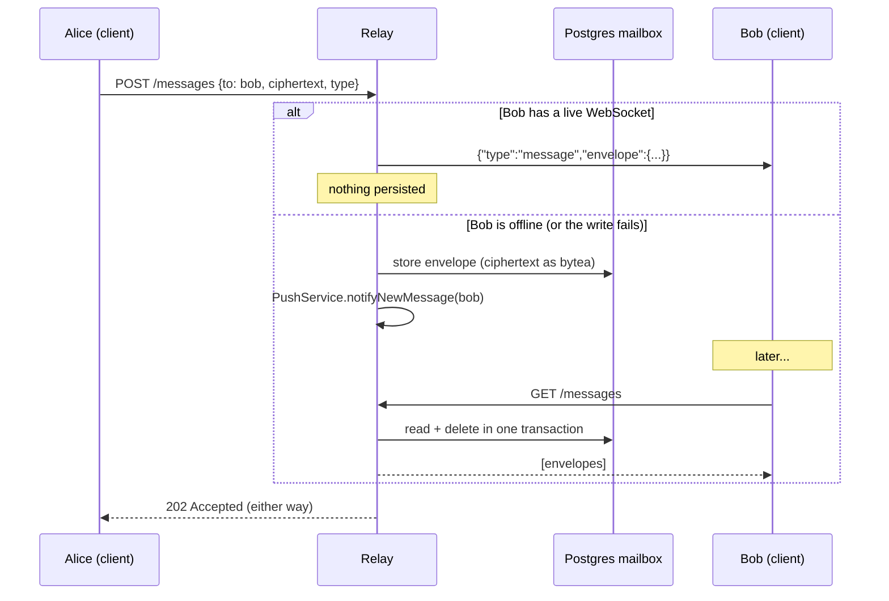

# gibbi relay

The backend for **gibbi**, an end-to-end encrypted messenger. It's a Spring Boot + Kotlin service that:

- registers users and issues JWTs
- hosts a **public key directory** (Signal-style prekey bundles, including post-quantum Kyber prekeys) so clients can start encrypted sessions
- **relays opaque ciphertext** between users, live over a WebSocket when the recipient is online, or through a store-and-forward mailbox when they aren't
- sends lightweight "pings" and (eventually) push wake-ups

The server never holds decryption keys and never sees plaintext. All encryption happens in the gibbi client (a separate Kotlin Multiplatform repo).

> The wire contract between this server and the client lives in **[Api.md](Api.md)**. It covers every endpoint, request/response shape, and WebSocket frame. This README covers running the server and how it works internally.

---

## Tech stack

| | |
|---|---|
| Language | Kotlin 2.2 on JVM 21 |
| Framework | Spring Boot 4.0 (Web, Security, Data JPA, Validation, WebSocket, Actuator) |
| Database | PostgreSQL 16 |
| Auth | JWT (jjwt 0.12), BCrypt password hashing |
| Build | Gradle 8.14 (wrapper included) |

---

## Running it

### Prerequisites

- **JDK 21**
- **Docker** (for PostgreSQL, or for running the whole stack)

### Required configuration

| Variable | Required | Purpose |
|---|---|---|
| `JWT_SECRET` | **yes** | HMAC key for signing tokens. **Must be at least 32 bytes**, or the app fails at startup with a `WeakKeyException`. Use 64+ bytes to get HS512. |
| `SPRING_DATASOURCE_URL` | no | Defaults to `jdbc:postgresql://localhost:5432/messaging` |
| `SPRING_DATASOURCE_USERNAME` | no | Defaults to `postgres` |
| `SPRING_DATASOURCE_PASSWORD` | no | Defaults to `devpass` |

Generate a proper secret:

```bash
openssl rand -base64 64
```

or in PowerShell:

```powershell
$b = New-Object byte[] 64; [Security.Cryptography.RandomNumberGenerator]::Create().GetBytes($b); [Convert]::ToBase64String($b)
```

### Option A: Run locally with Gradle (development)

**1. Start PostgreSQL** with credentials that match the defaults in `application.yml`:

```bash
docker run -d --name gibbi-dev-db -e POSTGRES_DB=messaging -e POSTGRES_PASSWORD=devpass -p 5432:5432 postgres:16
```

**2. Set the JWT secret** for the current shell.

PowerShell:
```powershell
$env:JWT_SECRET = "<paste generated secret>"
```

bash:
```bash
export JWT_SECRET="<paste generated secret>"
```

**3. Run the app:**

```bash
./gradlew bootRun
```

(`.\gradlew bootRun` on Windows.) The server listens on **http://localhost:8080**. Tables are created automatically on first start (`ddl-auto: update`).

The Android emulator reaches the host machine at `http://10.0.2.2:8080`.

### Option B: Run the full stack with Docker Compose

Compose builds the app image and runs it alongside PostgreSQL.

**1. Create a `.env` file** next to `docker-compose.yml` (it's gitignored):

```env
POSTGRES_DB=gibbi
POSTGRES_USER=gibbi_user
POSTGRES_PASSWORD=<a real password>
JWT_SECRET=<generated secret, 32+ bytes>
```

**2. Start it:**

```bash
docker compose up -d --build
```

The app is published on **http://127.0.0.1:8081** (bound to localhost only). PostgreSQL isn't exposed to the host at all. Data persists in the `gibbi_pgdata` volume.

```bash
docker compose logs -f app
```

```bash
docker compose down
```

### Build and test

```bash
./gradlew build
```

```bash
./gradlew bootJar
```

`bootJar` writes a runnable jar to `build/libs/`.

### Smoke test

```bash
curl http://localhost:8080/actuator/health
```

```bash
curl -X POST http://localhost:8080/auth/register -H "Content-Type: application/json" -d '{"username":"alice","password":"password123"}'
```

```bash
curl http://localhost:8080/me -H "Authorization: Bearer <token from register>"
```

> **PowerShell note:** `curl` in Windows PowerShell 5.1 is an alias for `Invoke-WebRequest`. Call `curl.exe` explicitly, and pass JSON from a file to avoid quoting issues: `curl.exe -X POST ... --data "@body.json"`.

---

## How it works

### Package layout

```
src/main/kotlin/com/ltslr/gibbi/
├── MessagingApplication.kt     entry point
├── auth/                       register/login, JWT issue + verify, request filter
├── config/                     Spring Security, WebSocket registration, validation error handler
├── keys/                       prekey bundle directory (upload, fetch, count)
├── messaging/                  send/drain messages, pings, push tokens, WebSocket handler
└── user/                       User entity, /me
```

### Authentication

- `POST /auth/register` hashes the password with **BCrypt** and returns a JWT. `POST /auth/login` does the same after verifying the password.
- Tokens are signed with `JWT_SECRET`. The subject is the username, and they expire after **24 hours** (`jwt.expiration-ms`). There's no refresh flow; clients log in again.
- `JwtAuthFilter` runs on every HTTP request. A valid `Authorization: Bearer <jwt>` header puts the username into the Spring Security context. Sessions are stateless.
- Everything except `/auth/**`, `/actuator/health`, `/error`, and the `/realtime` handshake requires a valid token.
- **The caller's identity always comes from the JWT, never from the request body.** There is no `from` field anywhere, so a sender can't be spoofed.

### Key directory

Before two users can talk, each client uploads a **prekey bundle**:

- identity key, registration ID
- a signed prekey + signature
- a Kyber (post-quantum) prekey + signature
- a batch of **one-time prekeys**

`POST /keys` replaces the caller's bundle and one-time prekeys. When Alice wants to message Bob, her client calls `GET /keys/bob`. That returns Bob's bundle plus **one** one-time prekey, which is deleted in the same transaction so it isn't handed out again. If Bob has run out, the one-time fields come back `null` and the session can still be set up using only the signed and Kyber prekeys. `GET /keys/count` lets a client see when it should upload more.

All key material is base64. The server stores and returns it without interpreting it.

### Message delivery



- The sender always gets **`202 Accepted`**, which means accepted, not delivered. The response doesn't say which path was taken.
- `GET /messages` **drains** the mailbox: entries come back oldest-first and are deleted in the same transaction.
- A live-delivered envelope and a drained envelope have the same JSON shape, so the client only parses one type.
- `type` is the libsignal message type (a PreKey message vs. a regular Signal message). It's routing metadata, not content.

### WebSocket (`/realtime`)

Spring Security allows the WebSocket handshake without a token. Authentication happens inside the protocol instead:

1. The client connects. The socket starts in a *pending* state: it isn't registered and can't receive anything.
2. The first frame must be `{"type":"auth","token":"<jwt>"}`. If the token is valid, the server replies `{"type":"auth_ok"}` and records the socket in `SessionRegistry` under that username.
3. If no valid auth frame arrives within **5 seconds**, the socket is closed. Other close causes:

   | Code | Reason |
   |---|---|
   | 1008 | `auth timeout` |
   | 1008 | `auth failed` (wrong frame type or invalid token) |
   | 1007 | `malform auth` (payload wasn't JSON) |

There's **one socket per username**, so a new connection replaces the old one. Once authenticated, frames sent by the client are currently ignored.

### Pings

`POST /ping {to}` is a contentless "Alice pinged you". Pings are not encrypted, since the relay already sees who talks to whom, and they are not stored, since a stale ping is worse than a dropped one.

- Rate-limited to one ping per **(from, to) pair every 3 seconds**. Extra pings get `429`, and spamming doesn't extend the cooldown.
- Unlike messages, a ping goes to **both** the WebSocket and push, because the socket may have died between the check and the write. Clients should dedupe.

### Push notifications

Clients register device tokens with `POST /push/register` (upserted by username + token; a user can have several devices). `PushService` sends wake-ups only. Its interface has no payload parameter, so message content can't end up in a push.

**Currently `NoOpPushService` is the only implementation. It just logs.** Real FCM delivery can be added behind the same interface without touching the controllers.

### Data model

| Table | Contents |
|---|---|
| `users` | username, BCrypt hash, created_at |
| `key_bundles` | one row per user: identity key, signed prekey, Kyber prekey, signatures |
| `one_time_prekeys` | owner, key ID, public key (deleted as they're handed out) |
| `mailbox` | recipient, sender, ciphertext (`bytea`), message type, created_at (deleted on drain) |
| `push_tokens` | username, device token, platform, updated_at |

The schema is managed by Hibernate `ddl-auto: update`. There are no migration files yet.

### Trust model

The relay stores and forwards **opaque ciphertext and routing metadata**. It has no keys and nowhere to put plaintext. What it *can* see is **who talks to whom, and when**, because it has to route envelopes and send wake-ups. It learns nothing about message content.

---

## Current limitations

- **Single instance only.** `SessionRegistry` (live sockets) and `PingRateLimiter` are in memory. Running more than one instance would need shared state, for example Redis.
- **Push is a stub.** Tokens are collected, but nothing is sent.
- **One device per user** on the WebSocket.
- **No schema migrations.** It relies on `ddl-auto: update`.
- **Consume-on-fetch isn't row-locked.** Two truly concurrent `GET /messages` (or `GET /keys/{user}`) calls could read the same rows before either delete commits.
- `kyberPreKeyId` has `@NotBlank` on an `Int`, which doesn't validate anything, so a missing value isn't rejected.
- `show-sql: true` is on, and the WebSocket allows all origins (`*`). Both are fine for development but should be tightened for production.
